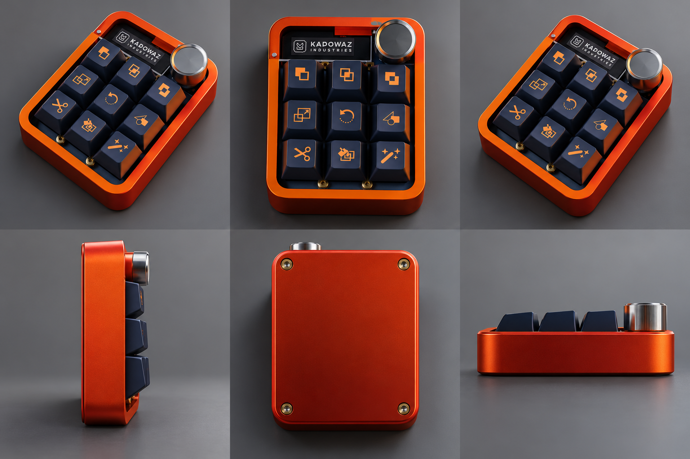
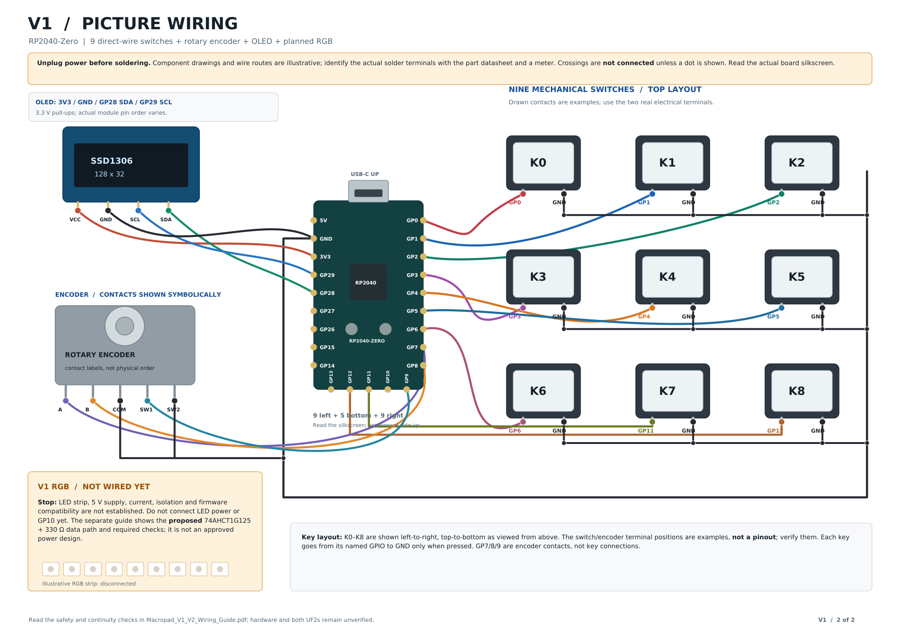
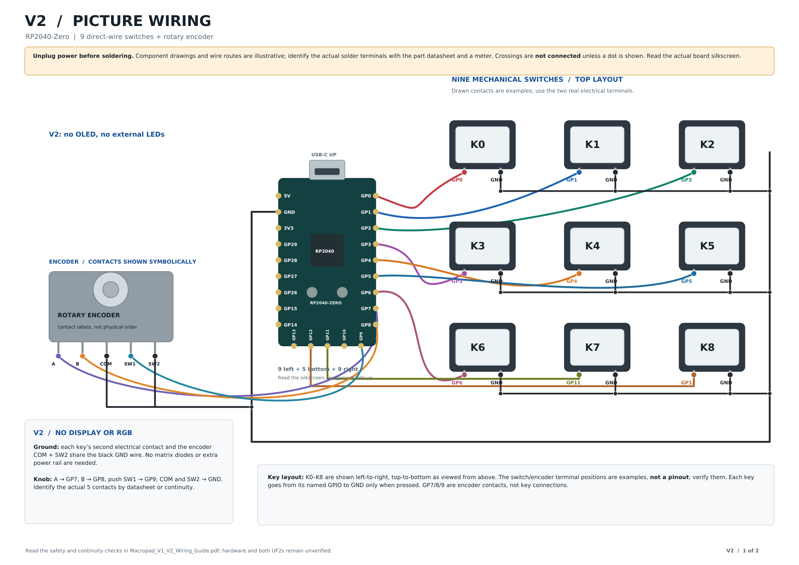

<div align="center">

# KADOWAZ Deck Studio

**A little deck for the shortcuts you use a lot.**

Design four layers of keys and a rotary knob, then upload them to an RP2040 macropad.

[Get started](#get-started) · [Build the hardware](#hardware--wiring) · [Firmware](#firmware) · [Documentation](#documentation)



<sub>Concept render — not a photograph of tested hardware.</sub>

</div>

---

KADOWAZ Deck Studio brings a desktop editor and RP2040 firmware together for a compact, customizable macropad: **nine keys, one clickable rotary encoder, and four layers**. Use it to organize shortcuts for creative apps, games, and everyday workflows, or start with a preset and make it your own.

> [!IMPORTANT]
> This is a work in progress. The physical hardware and both bundled firmware images have **not yet been tested on a real device**. The V1 RGB power design is not approved: leave the LED power and data disconnected. See the [hardware notes](#hardware--wiring) before building or powering anything.

## At a glance

| | What you can do |
| :--- | :--- |
| **Keys & layers** | Configure nine keys across Layer 0–3, edit labels and icons, and set knob actions. A fresh editor starts with empty key assignments. |
| **Presets** | Explore app- and game-focused layouts, customize them, and apply a preset to a chosen layer. Check shortcuts against your app's version and settings. |
| **Upload** | Review what can run on the pad, what needs the desktop app, and what cannot be uploaded before writing your configuration. |
| **Test & inspect** | Use the keyboard tester and, on compatible firmware, inspect physical events and read the pad's configuration without changing it. |
| **Display & lighting** | Configure OLED and lighting features in the editor. Actual hardware support depends on the firmware and wiring; RGB output is not ready to power. |
| **Backup** | Export and restore editor layers, knob settings, and saved presets on your PC. Restoring a backup does not write to the pad. |

The editor, the configuration stored on the pad, and actions executed by the PC are different things. Supported **on-device** actions can run after a successful upload; **PC-owned** actions need the desktop app running and compatible device event support. The upload review identifies these cases and blocks unsupported combinations.

## Get started

### What you'll need

- **Windows** for the primary desktop experience and Windows-specific integrations. The web editor and portions of the project can also be developed on macOS and Linux; native features vary by platform.
- **Node.js 20 and npm** for development (matching the CI configuration). A C compiler and `make` are also needed to generate host test artifacts.
- A **Waveshare RP2040-Zero**, nine normally-open switches, a rotary encoder with push switch, and a USB data cable for the proposed physical build. The V1 design additionally includes an optional SSD1306 display and a planned, currently unsafe-to-power RGB circuit.

### Run from source

```bash
git clone https://github.com/david-8837/MacroPad-.git
cd MacroPad-
npm ci

# Browser-based editor
npm run dev

# Electron desktop app (in a separate session, instead of npm run dev)
npm run electron:dev
```

The browser version is useful for exploring the interface, but it is not a substitute for the desktop runtime: native integrations and PC-owned actions may be unavailable. Access to a compatible device also depends on the browser and its serial support.

### Your first layout

1. Open **Keys**, select Layer 0–3, and assign the keys and knob. Or open **Presets**, choose a layout, and save it to a layer. Applying a preset replaces that layer's nine keys and gestures, but leaves its knob and other layers unchanged.
2. Connect a compatible pad and open **Upload to Deck**. Review the action ownership and compatibility information, then upload the layers.
3. Use **Tester** to check keyboard input. The physical pad inspector is separate; it requires compatible event reporting, and its readback does not import the pad's settings into the editor.
4. Edit and upload again whenever you want to change the layout. Back up your editor configuration separately if you want a portable copy.

For **Open App** assignments, the app list refreshes older cached icons in the background. Use the rescan button to refresh it again. Manually browsed entries are kept; apps whose icons Windows cannot provide use a generic fallback.

**Backups are not full device images.** They do not include macro definitions, display settings, or lighting settings. Backup validation rejects `script` and `macro` action categories; export or import can fail when those actions are present. Backup files can contain personal paths and action details, so share them carefully.

## Hardware & wiring

Two proposed builds use the same directly wired keys and knob:

| Build | Components | Status |
| :--- | :--- | :--- |
| **V2 — keys & knob** | RP2040-Zero, 9 switches, clickable rotary encoder | Wiring and firmware are prepared; physical testing is pending. |
| **V1 — full deck** | V2 controls plus a 128×32 I²C SSD1306 OLED and planned RGB | Display and firmware are untested; **do not connect or power the RGB circuit** until its power, isolation and signal design are approved. |

### Start with the complete guide

**[Open the complete wiring guide →](docs/Macropad_Complete_Wiring_Guide.pdf)**

Picture-style diagrams, soldering notes and reference schematics for both versions are collected in one PDF.

<details>
<summary>Preview the picture-style wiring sheets</summary>

| V1 · Display + planned RGB | V2 · Keys + knob |
| :---: | :---: |
| [](docs/Macropad_V1_Picture_Wiring.png) | [](docs/Macropad_V2_Picture_Wiring.png) |

[Picture diagrams PDF](docs/Macropad_Picture_Wiring_V1_V2.pdf) · [Soldering and schematic guide PDF](docs/Macropad_V1_V2_Wiring_Guide.pdf)

</details>

### GPIO quick reference

The nine normally-open switches each connect between their GPIO and common ground, with internal pull-ups. Key numbers are row-major:

```text
K0  GP0     K1  GP1     K2  GP2
K3  GP3     K4  GP4     K5  GP5
K6  GP6     K7  GP11    K8  GP12
```

| Connection | RP2040-Zero signal |
| :--- | :--- |
| Encoder A / B / push | GP7 / GP8 / GP9; encoder common and the other push terminal to GND |
| V1 OLED SDA / SCL | GP28 / GP29; a 3.3 V-compatible SSD1306 module at I²C address `0x3C` |
| V1 OLED supply | 3V3 and GND; check whether the module already has I²C pull-ups |
| Planned RGB data | GP10 is reserved in the design; **leave LED data and power disconnected** |

Before soldering, verify the **GPIO labels on your actual board** and the encoder contacts against its datasheet or with a multimeter. Pin-number conventions vary between footprints. Inspect for shorts and follow the power and verification steps in the complete guide; the diagrams are not a substitute for testing the actual components.

## Firmware

The desktop flasher offers two bundled choices: **Full Deck** and **Keys & Knob**. Enter the RP2040's BOOTSEL mode, select the appropriate image in the app, and follow the flash flow. You do not need to choose a UF2 file manually.

| Bundled image | What is known |
| :--- | :--- |
| **Full Deck** | Original supplied UF2, retained unchanged and structurally checked. Its source, boot behavior, pin map and LED behavior are not verified against this repository or real hardware. |
| **Keys & Knob** | Built from the current firmware source for the direct-wire layout and host-tested; not yet boot-tested on physical hardware. |

Both images are experimental. In particular, do not assume the Full Deck UF2 has safe LED settings. The [bundled firmware notes](electron/firmware/README.md) include image details and checksums.

### Build firmware from source

Install the [Raspberry Pi Pico SDK](https://github.com/raspberrypi/pico-sdk), CMake, and an ARM embedded toolchain, and set `PICO_SDK_PATH` to your SDK checkout. From the repository root:

```bash
# Full source configuration (LED output defaults to off)
cmake -S firmware -B firmware/build -DPICO_BOARD=waveshare_rp2040_zero
cmake --build firmware/build -j4

# Keys and knob only, in a separate build directory
cmake -S firmware -B firmware/build-keys -DPICO_BOARD=waveshare_rp2040_zero -DMPAD_KEYS_ONLY=ON
cmake --build firmware/build-keys -j4
```

The builds produce `mpad3.uf2` in their respective build directories. A source build is not evidence of a successful physical boot or safe LED power design.

## Development & checks

After dependencies are installed, run these from the repository root:

```bash
npm test                    # TypeScript, app/host tests and protocol checks
npm run build               # Vite production build
npm run build:electron      # Build Electron main process and verify native assets
npm run pack                # Build an unpacked desktop app
npm run dist:win            # Build Windows distribution packages

python3 tools/check_board.py --check
bash scripts/test-all.sh        # Host-side firmware and protocol checks
bash scripts/test-all.sh --arm  # Also cross-compile; requires the Pico SDK and ARM toolchain
```

`npm test` can generate host artifacts using `make` and a C compiler if they are missing. Packaging requires a suitable Electron build environment. CI is configured for Node 20 on Windows, Linux, and macOS, with a Windows packaging check. Automated checks do not replace testing the actual board, USB connection, display, or operating-system integrations.

### Project map

```text
src/                 React editor and UI
electron/            Electron main process, native integrations and bundled UF2s
host/                MPAD3 host protocol and tests
firmware/            Pico SDK firmware and host-side firmware tests
docs/                Hardware, protocol and feature documentation
tools/               Generators and validation scripts
```

## Documentation

- [Complete wiring guide](docs/Macropad_Complete_Wiring_Guide.pdf) — the combined V1 and V2 build reference
- [Hardware overview](docs/HARDWARE.md) — components, pinout and electrical notes
- [User guide](docs/USER_GUIDE.md) — editor and device workflows
- [Architecture](docs/ARCHITECTURE.md) and [MPAD3 protocol](docs/PROTOCOL.md) — how the pieces communicate
- [OLED modes](docs/OLED_MODES.md) and [lighting page](docs/LIGHTING_PAGE.md) — feature details and limitations
- [Preset shortcut sources](docs/PRESET_SHORTCUT_SOURCES.md) — sources and shortcut caveats
- [Release checklist](docs/RELEASE_CHECKLIST.md) — pending Windows and physical-device checks
- [Bundled firmware](electron/firmware/README.md) — UF2 provenance, checksums and testing status

Some detailed documents describe earlier stages of development; where they conflict with current behavior, check the source and the current safety notes above.

## License & third-party assets

This checkout does not currently contain a repository-wide `LICENSE` file. Third-party preset icons have their own attribution and license information in [the icon assets directory](src/assets/preset-icons/README.md).
