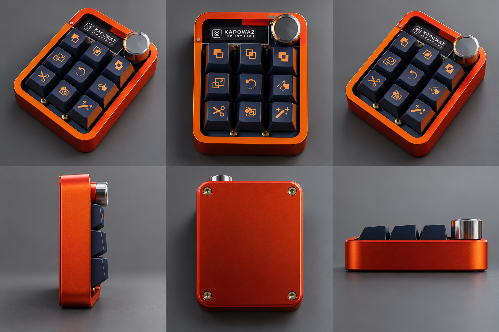

# KADOWAZ DECK STUDIO

<p align="center">
  
</p>

<p align="center">
  <strong>Next-Generation 9-Key Macropad Desktop Studio & Hardware Companion Engine</strong>
</p>

<p align="center">
  
  
  
  
  
  
  
</p>

---

## 📌 Table of Contents

1. [Overview](#overview)
2. [Key Architecture & Dual-Engine Model](#key-architecture--dual-engine-model)
3. [Core Feature Breakdown](#core-feature-breakdown)
   - [1. Automatic Application Discovery & Launcher](#1-automatic-application-discovery--smart-launcher)
   - [2. Three Independent Layers (Layer 1, Layer 2, Layer 3)](#2-three-independent-layers-layer-1-layer-2-layer-3)
   - [3. Digital Twin & Visual Keycaps](#3-digital-twin--visual-keycaps)
   - [4. Switch Configuration Drawer](#4-switch-configuration-drawer)
   - [5. Rotary Encoder Engine](#5-rotary-encoder-engine)
   - [6. OLED Display Control (SSD1306)](#6-oled-display-control-ssd1306)
   - [7. PC Shortcuts Vault](#7-pc-shortcuts-vault)
   - [8. VIA Hardware Suite](#8-via-hardware-suite)
   - [9. Safety Isolation (Long-Press Protection)](#9-safety-isolation-long-press-protection)
   - [10. Embedded Localhost REST & Webhook Daemon](#10-embedded-localhost-rest--webhook-daemon)
4. [Hardware & Firmware Integration](#hardware--firmware-integration)
   - [Recommended Hardware Bill of Materials (BOM)](#recommended-hardware-bill-of-materials-bom)
   - [Firmware Options (Pico SDK C vs Arduino)](#firmware-options)
   - [Hardware Wiring & Electrical Guide (`docs/HARDWARE.md`)](./docs/HARDWARE.md)
   - [Firmware Architecture & Event Pipeline (`docs/ARCHITECTURE.md`)](./docs/ARCHITECTURE.md)
   - [Binary Wire Protocol Specification (`docs/PROTOCOL.md`)](./docs/PROTOCOL.md)
   - [Hardware Pinout & Wiring Configurations](#hardware-pinout--wiring-configurations)
   - [Serial Protocol Specification](#serial-protocol-specification-115200-baud)
5. [Project Structure](#project-structure)
6. [Installation & Development Guide](#installation--development-guide)
   - [Desktop App Setup](#1-install-dependencies)
   - [Firmware Flashing & UF2 Build](#5-firmware-build--flashing-rp2040-zero)
   - [Testing & Quality Verification](#6-testing--verification)
7. [Security & Safe Execution](#security--safe-execution)

---

## 🌟 Overview

**KADOWAZ Deck Studio** is a professional desktop suite designed to configure, monitor, and empower physical 9-key mechanical macropads equipped with a rotary encoder, an I2C OLED display (SSD1306), and USB HID / Serial microcontrollers (Raspberry Pi Pico RP2040, Arduino Pro Micro ATmega32U4, ESP32-S3).

It bridges the gap between hardware key actuation and operating-system automation—offering multi-source Windows application discovery, live application launching, 3 isolated operational layers, multi-key combo recording, VIA keycode remapping, safety-isolated long-press actions, and an embedded webhook API server.

---

## 🏗 Key Architecture & Dual-Engine Model

The software uses a dual-engine architecture:

```
┌─────────────────────────────────────────────────────────────────────────────┐
│                       KADOWAZ Deck Studio Companion                         │
│                                                                             │
│  ┌───────────────────────┐  ┌───────────────────────┐  ┌─────────────────┐  │
│  │  Deck Studio Twin UI  │  │  Application Library  │  │ Shortcuts Vault │  │
│  └───────────┬───────────┘  └───────────┬───────────┘  └────────┬────────┘  │
│              │                          │                       │           │
│              └──────────────────────────┼───────────────────────┘           │
│                                         ▼                                   │
│                        ┌─────────────────────────────────┐                  │
│                        │ Profiles & Multi-Layer Store    │                  │
│                        │ (Layer 1, Layer 2, Layer 3)     │                  │
│                        └────────────────┬────────────────┘                  │
│                                         │                                   │
│                    ┌────────────────────┴───────────────────┐               │
│                    │                                        │               │
│                    ▼                                        ▼               │
│      ┌───────────────────────────┐            ┌──────────────────────────┐  │
│      │  Electron Main Process    │            │  hardwareBridge.ts       │  │
│      │  • Multi-Source Discovery │            │  • WebHID API            │  │
│      │  • Native Icon Extractor  │            │  • WebSerial CDC Stream  │  │
│      │  • Safe Process Spawner   │            │  • EEPROM Packet Sync    │  │
│      │  • Webhook REST (38491)   │            └─────────────┬────────────┘  │
│      └─────────────┬─────────────┘                          │               │
└────────────────────┼────────────────────────────────────────┼───────────────┘
                     │ OS Shell / Process Spawn               │ USB CDC / HID
                     ▼                                        ▼
          ┌─────────────────────┐                 ┌───────────────────────┐
          │  Windows OS / Apps  │                 │  Micro Pad Hardware   │
          │  (Code, Chrome,     │                 │  (3x3 Matrix, Knob,   │
          │   Spotify, Discord) │                 │   SSD1306 OLED)       │
          └─────────────────────┘                 └───────────────────────┘
```

1. **Hardware Layer (Physical Macropad):**
   - Scans the 3x3 mechanical switch matrix and rotary encoder detents with hardware debouncing.
   - Emits compact ASCII CDC protocol messages (e.g. `KEY:0:DOWN`, `KEY:0:UP`, `ENC:CW`, `ENC:CCW`, `ENC:DOWN`).
   - Receives text packets to render live telemetry on the 128x32/64 OLED display.

2. **Desktop Companion Layer (Electron + React):**
   - Handles the complex logic the microcontroller memory cannot perform: process launching, window focusing, file picking, active profile switching, and app discovery.
   - Listens to physical keystrokes over WebHID / WebSerial, maps them to the active layer, and triggers the configured action.

---

## ⚡ Core Feature Breakdown

### 1. Automatic Application Discovery & Smart Launcher

The application discovery engine (`electron/appDiscovery.cjs`) discovers installed programs across Windows 10 & 11 without executing applications or running slow disk scans:

- **5 Discovery Vectors:**
  1. **Start Menu Shortcuts (`.lnk`):** Scans `%APPDATA%\Microsoft\Windows\Start Menu\Programs` and `%PROGRAMDATA%\Microsoft\Windows\Start Menu\Programs`, resolving targets via `shell.readShortcutLink`.
  2. **Registry Uninstall Entries:** Queries 64-bit and 32-bit `Uninstall` keys (`HKLM` and `HKCU`) to extract application names, `DisplayIcon` resources, and installation paths.
  3. **Microsoft Store / Packaged Apps (UWP / MSIX):** Discovers registered modern Windows applications via `Get-StartApps` with their App User Model IDs (AUMIDs).
  4. **App Paths Registry:** Extracts registered executables from `...\CurrentVersion\App Paths`.
  5. **PATH Environment:** Discovers CLI tools, compilers, and editors located on the system `PATH`.
- **High-Resolution Icon Extraction:** Uses Electron's native `app.getFileIcon` API to extract icons from executables and shortcuts into base64 `data:image/png;base64,...` URLs.
- **Browse for App (`.exe` / `.lnk`):** Native Windows file chooser integration for portable software or utilities located in non-standard directories.
- **Safe Execution:** Spawns executables using argument arrays without concatenating shell strings, opens packaged apps via `shell:AppsFolder\<AUMID>`, and launches shortcuts via `shell.openPath`.
- **Advanced Launch Settings:** Focus existing window if already open, launch minimized, custom key labels, and optional command-line flags.

---

### 2. Three Independent Layers (Layer 1, Layer 2, Layer 3)

The Micro Pad supports **three fully independent hardware layers** (`Layer 1`, `Layer 2`, `Layer 3`), each maintaining 9 independent programmable switches:

| Layer | Default Role | Rotary Encoder Mode | Switch Setup Example |
| :--- | :--- | :--- | :--- |
| **Layer 1** | Primary Desktop / Productivity | Master Volume Control | VS Code, Chrome, Terminal, Slack |
| **Layer 2** | Media Production / Editing | Timeline Scrubbing | Cut, Ripple Delete, Blade, Render |
| **Layer 3** | Audio Session & Streaming | Focused App Audio (Discord/Spotify) | Mute Mic, Toggle Stream, Deafen |

- **Complete Isolation:** Changing a switch or knob action in Layer 1 never modifies Layer 2 or Layer 3.
- **Dedicated Knob Hold for Layer Switching:** Pressing and holding the rotary knob ($\ge 800\text{ ms}$) is strictly dedicated to cycling through the 3 layers (**Layer 1 → Layer 2 → Layer 3**). It cannot be accidentally overwritten with arbitrary macros.
- **Total Customizable Action Capacity:**

| Input Control | Per Layer | Total Across 3 Layers | Description |
| :--- | :---: | :---: | :--- |
| **Mechanical Switches (#1 – #9)** | 9 keys | **27 keys** | Hotkeys, macros, safety holds, or app launchers |
| **Knob Tap (Push / Click)** | 1 action | **3 actions** | Momentary push macro (Mute, Play/Pause, Enter) |
| **Knob Scroll CW (Turn Right)** | 1 action | **3 actions** | Clockwise rotation macro (Vol Up, Zoom In, Scrub) |
| **Knob Scroll CCW (Turn Left)** | 1 action | **3 actions** | Counter-CW rotation macro (Vol Down, Zoom Out) |
| **Knob Hold ($\ge 800\text{ ms}$)** | *Dedicated* | **Layer Cycle** | Strictly reserved to cycle Layer 1 → Layer 2 → Layer 3 |
| **Total Customizable Actions** | **12 / layer** | **36 distinct actions** | 100% independent per layer |

---

### 3. Digital Twin & Visual Keycaps

The **Digital Twin** provides a pixel-perfect, interactive representation of your physical device:
- **Actual App Icons on Keycaps:** When a switch is configured to launch an application, the switch dish renders the real application icon extracted from Windows.
- **Live Actuation Feedback:** Depressing keys in the UI or on the physical macropad lights up the key dish with real mechanical switch animations.
- **Underglow Glow & Colors:** Configurable per-switch accent colors that shine through switch cutouts.

---

### 4. Switch Configuration Drawer

Clicking any switch in Deck Studio opens the unified Configuration Drawer:
- **Tab 1: Keyboard & Combos:** Full 15u visual keyboard supporting ANSI/ISO layout, modifiers (`Ctrl`, `Alt`, `Shift`, `Win`), and dual recording modes (`append` and `chord`).
- **Tab 2: Keystroke Recorder:** Records live hardware key chords directly from your computer keyboard.
- **Tab 3: Text Macro:** Types out boilerplate text snippets, code templates, or emails upon pressing the switch.
- **Tab 4: Safety Hold:** Isolates destructive actions (e.g. terminating a broadcast or closing processes) behind a sustained long-press (500ms to 4000ms) with animated visual filling.
- **Tab 5: Open App:** Dedicated application picker featuring instant search, category filters, browse fallback, custom label overrides, and launch arguments.

---

### 5. Rotary Encoder Engine

The rotary knob supports bi-directional rotation and an integrated push button:
- **Clockwise (CW) & Counter-Clockwise (CCW):** Configurable actions per rotation detent.
- **Velocity Acceleration Curves:**
  - `Linear`: 1-to-1 detent response.
  - `Exponential`: Rotates faster during rapid turns (ideal for volume or long timeline scrubbing).
  - `Precision Nudge`: Ultra-fine adjustments for color grading or frame-by-frame jog.
- **Hold-to-Switch Layer:** Sustained hold switches the entire macropad layer without needing extra keys.

---

### 6. OLED Display Control (SSD1306)

Control the 128x32 / 128x64 I2C OLED display directly from software:
- **Operating Modes:**
  - `channel`: Minimalist industrial Layer Stepper Track with high-contrast inverted active layer badge (`[01]`, `[02]`, `[03]`).
  - `kadowaz`: Industrial branding and version indicator.
  - `system`: Live PC telemetry (CPU load %, GPU load %, RAM %, CPU temperature).
  - `media`: Now-playing track title, artist name, and progress bar.
  - `visualizer`: Stereo L/R audio VU peak meter.

#### Layer-Switch Stepper Display (Dual Hardware & Software Parity)

Whenever you switch layers (by pressing and holding the rotary knob for $\ge 800\text{ ms}$, or switching in the desktop software), the OLED screen immediately displays a sleek, high-contrast segmented track with an inverted rounded badge indicating the active layer:

```
Layer 01 Active:
┌────────────────────────────────────────────────────────┐
│   ██████                                               │
│   █ 01 █ ────────   ──────────   ──────────            │
│   ██████                                               │
└────────────────────────────────────────────────────────┘

Layer 02 Active:
┌────────────────────────────────────────────────────────┐
│                ██████                                  │
│   ──────────   █ 02 █ ──────────   ──────────          │
│                ██████                                  │
└────────────────────────────────────────────────────────┘

Layer 03 Active:
┌────────────────────────────────────────────────────────┐
│                                 ██████                 │
│   ──────────   ──────────   ────█ 03 █ ────            │
│                                 ██████                 │
└────────────────────────────────────────────────────────┘
```

- **Visual Design:**
  - **Inverted Active Badge:** Solid white rounded pill with deep black monospace numbers (`01`, `02`, `03`).
  - **Dashed Stepper Line:** 3.5 px thick horizontal track running across the display, visually showing the current layer position relative to the 3 layers.
  - **Temporary Pop-Up Overlay:** When you switch layers while using System Metrics or Equalizer modes, the Layer Stepper smoothly pops over the screen for 2.6 seconds before reverting back.
  - **Persistent Mode:** You can also lock the OLED screen permanently into `Layer Indicator` mode via the Display Config Drawer.
- **Direct Serial Transmission:** Software pushes display updates via serial protocol commands (`OLED:CH:<1-3>` or `OLED:<text>`).

---

### 7. PC Shortcuts Vault

A built-in curated vault of shortcuts categorized by application:
- **Creative & Editing:** DaVinci Resolve, Adobe Premiere Pro, Blender 3D, Adobe Photoshop, Figma, Canva.
- **Developer Tools:** VS Code, Git, Windows Terminal, PowerShell.
- **Streaming & Voice:** OBS Studio, Discord, Spotify.
- **Windows Utilities:** Snipping Tool, Task Manager, Virtual Desktop Switcher.

---

### 8. VIA Hardware Suite

Complete compatibility for custom keyboard enthusiasts:
- **Key Matrix Tester:** Live 3x3 interactive switch tester with actuation count and debounce state tracking.
- **Lighting Studio:** Control RGB underglow brightness, saturation, hue, and animation effects.
- **Macro Editor:** Multi-step macro engine supporting up to 16 macros (`M0` to `M15`).
- **Keycode Remapper:** Direct raw hex keycode assignment compatible with QMK / VIA standards.

---

### 9. Safety Isolation (Long-Press Protection)

Destructive commands (such as stopping a recording, closing active apps, or resetting channels) can be flagged with **Destructive Safety**:
- Normal taps are ignored.
- The switch must be continuously held down for the user-configured duration (default: 1500ms).
- A radial progress indicator fills the keycap before the action is dispatched.

---

### 10. Embedded Localhost REST & Webhook Daemon

KADOWAZ Deck Studio runs an embedded HTTP server on port `38491` (`127.0.0.1:38491`):
- **Status Endpoint (`GET /api/v1/status`):**
  ```json
  { "status": "online", "app": "KADOWAZ Deck Studio", "port": 38491 }
  ```
- **Webhook Input (`POST /api/v1/action`):**
  Accepts external JSON automation payloads from Elgato Stream Deck plugins, Bitfocus Companion, Touch Portal, or cURL scripts to trigger profiles or layer switches remotely.

---

## 🔌 Hardware & Firmware Integration

### 🛠 Recommended Hardware Bill of Materials (BOM)

Here is the recommended component list to build your custom Micro Pad hardware:

#### 1. RP2040-Zero
*Keep this.* Your main controller. It handles the nine mechanical keys, rotary encoder quadrature decoding, WS2812B RGB effects, and three independent layers over USB CDC/HID serial communication.

#### 2. MX-Style Through-Hole Mechanical Switches × 9
Best for hand soldering because the electrical contact pins are large and easy to access. Solder the switches directly to the PCB or perfboard; hot-swap sockets are not strictly necessary.

#### 3. WS2812B-Compatible 5050 Addressable RGB LEDs × 9
Choose a strip or larger 5050 LED package rather than tiny 2020 LEDs. The larger solder pads are much easier to solder by hand, and each LED can still display its own independent color and animation effect.
> **Assembly Tip:** If using LED strip sections, cut at the marked copper cut points and mount each LED directly beneath its corresponding key switch. Check that the strip's physical dimensions fit your key switch spacing.

#### 4. EC11 Rotary Encoder with Push Switch × 1
Gives you stepped left rotation (CCW), right rotation (CW), and push button press.
- **Rotary Macros:** Tap the knob to trigger the assigned layer's knob press action.
- **Dedicated Layer Switching:** Press and hold the knob ($\ge 800\text{ ms}$) to cycle through the 3 layers (**Layer 1 → Layer 2 → Layer 3**).

#### 5. 0.91-inch I2C OLED Display Module (4-Pin, 128×32, SSD1306) × 1
Compact monochrome display mounted horizontally on the top bezel above the key switches next to the rotary knob.
- **Pinout (4 Pins):** `GND`, `VCC` (3.3 V / 5 V compatible), `SCL` (I2C Clock), `SDA` (I2C Data).
- **Default I2C Address:** `0x3C`.
- **Role:** Renders the minimalist Layer Stepper track with inverted active badge (`[01]`, `[02]`, `[03]`), real-time PC telemetry (CPU/GPU load & temp), 12-band stereo audio VU equalizer, and media track progress.
- **Form Factor:** The slim 0.91-inch 128×32 aspect ratio fits the top chassis window perfectly without protruding over the mechanical keycaps.

#### Supporting Components & Circuit Protection

| Component | Quantity | Why & Circuit Rationale |
| :--- | :---: | :--- |
| **1N4148 diodes** | 9 | Key matrix isolation and anti-ghosting (*Required for 3x3 Matrix / Method B; 0 diodes needed if using Direct GPIO / Method A*) |
| **SN74AHCT125 buffer** | 1 | Reliable 3.3 V to 5 V logic level translation for the WS2812B LED data line |
| **330 Ω resistor** | 1 | LED data-line current and voltage ringing protection |
| **470–1000 µF capacitor, 6.3 V or higher** | 1 | Smooths the LED 5 V power rail against inrush current draw |
| **100 nF ceramic capacitor** | 1 | Local high-frequency bypass capacitor near logic ICs |
| **Perfboard or custom PCB** | 1 | Rigid structural base plate for switch and wiring mounting |
| **USB-C data cable** | 1 | High-speed PC connection for USB CDC/HID communication |
| **Hookup wire, solder and heat-shrink** | As needed | Assembly, wiring runs, and electrical insulation |

---

### Firmware Options

The project includes two firmware implementations depending on your development workflow:

1. **Native RP2040 Pico SDK C Firmware (`firmware/`)** *(Recommended for Production)*:
   - Built specifically for the **Waveshare RP2040-Zero**.
   - **Hardware PIO + DMA WS2812 Driver:** Bit timing is executed by dedicated RP2040 hardware state machines; LED colors never glitch or drop frames during USB data transfer.
   - **Standalone HID Keyboard & Media Dial:** Enumerates as a true USB Composite device (Keyboard + Consumer Control + CDC). Works seamlessly on Windows, macOS, and Linux without the desktop app running.
   - **On-Chip Flash Persistence:** Full 1,708-byte layout saved in onboard flash; your bindings and lighting persist through reboots.
   - **Gesture Engine:** Immediate hold triggering, double-tap detection, and rotational cancellation (turning the knob cancels hold to prevent accidental layer switches).
   - **Comprehensive Documentation:**
     - [`docs/HARDWARE.md`](./docs/HARDWARE.md) — Exact 23-pin header pinout, wiring schematics, and level-shifter guide.
     - [`docs/ARCHITECTURE.md`](./docs/ARCHITECTURE.md) — Modular architecture and state engine design.
     - [`docs/PROTOCOL.md`](./docs/PROTOCOL.md) — Wire protocol and CRC-16 specification.

2. **Arduino IDE Firmware (`firmware/kadowaz_macropad/`)**:
   - Single-file Arduino `.ino` sketch for quick hobbyist editing and testing across RP2040, Arduino Pro Micro (ATmega32U4), or ESP32-S3 boards.

---

### Hardware Pinout & Wiring Configurations

Depending on your chosen firmware, two wiring topologies are supported:

#### Method A: Direct GPIO Wiring (Recommended for Native Pico SDK C Firmware)
Connect each switch directly between its own dedicated GPIO pin and **GND**. The RP2040's internal pull-ups (`PULL_UP`) handle debouncing and sensing. **Zero diodes required!**

| Component | RP2040 Pin | Details |
| :--- | :--- | :--- |
| **Key Switches 0 to 6** | `GP0`, `GP1`, `GP2`, `GP3`, `GP4`, `GP5`, `GP6` | Direct switch connection to `GND` (internal pull-up) |
| **Key Switches 7 & 8** | `GP11`, `GP12` | Direct switch connection to `GND` (internal pull-up) |
| **WS2812B RGB Data** | `GP7` | PIO0 State Machine 0 via 74AHCT125 level shifter to 5V |
| **Encoder Pin A (Phase A)** | `GP8` | Quadrature encoder input with glitch filter |
| **Encoder Pin B (Phase B)** | `GP9` | Quadrature encoder input with glitch filter |
| **Encoder Push Switch** | `GP10` | Tactile push switch to `GND` (active-low) |
| **I2C OLED SDA** | `GP14` | I2C1 Data (Address `0x3C`, 4.7kΩ pull-up to 3.3V) |
| **I2C OLED SCL** | `GP15` | I2C1 Clock (Address `0x3C`, 4.7kΩ pull-up to 3.3V) |

*Full schematic, board layout, and bypass capacitor locations are detailed in [`docs/HARDWARE.md`](./docs/HARDWARE.md).*

#### Method B: 3×3 Matrix Wiring (Arduino IDE Sketch `kadowaz_macropad.ino`)
Scans switches in a 3×3 grid using 3 row outputs and 3 column inputs. **Requires 9× 1N4148 diodes** (one in series with each switch, cathode facing row) to prevent ghosting during multi-key combos.

| Component | Pin (Arduino Reference) | Details |
| :--- | :--- | :--- |
| **Matrix Rows (3)** | Pins `2`, `3`, `4` | Scanned as digital outputs (`LOW` active) |
| **Matrix Columns (3)** | Pins `5`, `6`, `7` | Digital inputs with `INPUT_PULLUP` |
| **Encoder Pin A** | Pin `8` | Phase A quadrature input |
| **Encoder Pin B** | Pin `9` | Phase B quadrature input |
| **Encoder Push Switch** | Pin `10` | Tactile push switch (`INPUT_PULLUP`) |
| **I2C OLED SDA** | Pin `4` (RP2040 GP4) | I2C Data (Address `0x3C`) |
| **I2C OLED SCL** | Pin `5` (RP2040 GP5) | I2C Clock (Address `0x3C`) |
| **WS2812B RGB Data** | Pin `1` (RP2040 GP1) | Serial NeoPixel data rail |

---

### Serial Protocol Specification (115200 Baud)

| Direction | Command Message | Meaning |
| :--- | :--- | :--- |
| **MCU → PC** | `KEY:<0-8>:DOWN` | Switch index (0 to 8) pressed |
| **MCU → PC** | `KEY:<0-8>:UP` | Switch index (0 to 8) released |
| **MCU → PC** | `ENC:CW` | Rotary knob rotated clockwise 1 detent |
| **MCU → PC** | `ENC:CCW` | Rotary knob rotated counter-clockwise 1 detent |
| **MCU → PC** | `ENC:DOWN` / `ENC:UP` | Rotary knob push button pressed / released |
| **MCU → PC** | `LAYER:<1-3>` / `CHANNEL:<1-3>` | Emitted when rotary knob hold ($\ge 800\text{ ms}$) switches the layer on the hardware |
| **MCU → PC** | `ENC:HOLD_SWITCH` | Confirmation that hardware knob hold triggered a layer switch |
| **PC → MCU** | `OLED:LAYER:<1-3>` / `OLED:CH:<1-3>` | Renders the inverted active layer badge (`[01]`, `[02]`, `[03]`) and stepper track |
| **PC → MCU** | `OLED:<text>` | Updates text displayed on the OLED screen |

#### OLED Layer Stepper Firmware Implementation (`firmware/kadowaz_macropad/kadowaz_macropad.ino`)

The firmware implements high-speed direct hardware rendering using `Adafruit_SSD1306` and `Adafruit_GFX`:

```cpp
void drawChannelScreen(uint8_t channel) {
  display.clearDisplay();
  const int lineY = 14;   // Center vertical baseline
  const int lineH = 3;    // Dash thickness
  const int badgeY = 8;
  const int badgeH = 16;
  const int badgeW = 28;
  const int badgeR = 3;   // Rounded corner radius

  if (channel == 2) {
    // Layer 02 Active: Dash on left, inverted badge in center, two dashes on right
    display.fillRect(24, lineY, 20, lineH, SSD1306_WHITE);
    display.fillRoundRect(50, badgeY, badgeW, badgeH, badgeR, SSD1306_WHITE);
    display.setTextColor(SSD1306_BLACK, SSD1306_WHITE);
    display.setTextSize(1);
    display.setCursor(58, badgeY + 4);
    display.print(F("02"));
    display.fillRect(84, lineY, 18, lineH, SSD1306_WHITE);
    display.fillRect(108, lineY, 14, lineH, SSD1306_WHITE);
  }
  display.display();
}
```

---

## 📁 Project Structure

```
desktop-app/
├── docs/                       # Detailed Hardware, Architecture & Protocol Specs
│   ├── HARDWARE.md             # Complete RP2040-Zero wiring, pin table & level-shifter guide
│   ├── ARCHITECTURE.md         # Microcontroller modular design & event pipeline
│   └── PROTOCOL.md             # Wire protocol & CRC-16 specification
│
├── electron/
│   ├── actionExecutor.cjs      # Safe Windows process spawner & keystroke executor
│   ├── appDiscovery.cjs        # Multi-source Windows application discovery & launcher engine
│   ├── main.cjs                # Electron main process, tray menu, window management & IPC
│   ├── preload.cjs             # Safe context bridge exposing electronAPI to React
│   ├── run-electron.cjs        # Electron runner script
│   └── webhookServer.cjs       # Localhost REST & webhook daemon (port 38491)
│
├── firmware/
│   ├── CMakeLists.txt          # Native Raspberry Pi Pico SDK C build configuration
│   ├── Makefile.host           # Host-runner test makefile for C unit tests
│   ├── include/                # Firmware headers (board.h, gesture.h, leds.h, magic.h, etc.)
│   ├── src/                    # Firmware C sources (core, drivers, lighting, storage, usb)
│   ├── tests/                  # 946 C firmware unit test assertions
│   └── kadowaz_macropad/       # Arduino IDE compatibility sketch (.ino)
│
├── host/
│   ├── protocol/
│   │   ├── protocol.json       # Wire protocol JSON definition
│   │   ├── mpad3-protocol.mjs  # Browser & Node JavaScript framing & CRC-16 codec
│   │   └── generated/          # Generated TypeScript definitions
│   └── tests/
│       └── run.mjs             # 113 automated wire protocol & struct tests
│
├── scripts/
│   ├── setup.sh                # Automated toolchain installer and firmware builder
│   └── test-all.sh             # End-to-end verification test suite
│
├── tools/                      # Python verification & simulation tools
│   ├── check_board.py          # Pin map cross-check validator
│   ├── check_usb_descriptors.py# HID USB report descriptor checker
│   ├── gen_protocol.py         # Wire protocol code generator
│   └── pio_timing.py           # Cycle-accurate WS2812 PIO waveform simulator
│
├── src/                        # React Desktop Studio frontend
│   ├── components/
│   │   ├── AppLauncherPanel.tsx    # Full Application Library browser & assignment panel
│   │   ├── DigitalTwin.tsx         # Interactive hardware visualizer & layer controls
│   │   ├── DisplayConfigDrawer.tsx # OLED display settings drawer
│   │   ├── KeyConfigDrawer.tsx     # Switch remap drawer (Keyboard, Macro, Safety, Open App)
│   │   ├── KeyMatrix.tsx           # 3x3 Keycaps with dynamic app icons & LED underglow
│   │   ├── KnobConfigDrawer.tsx    # Rotary knob curves, sensitivity & layer hold config
│   │   ├── OLEDDisplay.tsx         # OLED display component (visualizer, media, system)
│   │   ├── OSDFlyout.tsx           # On-screen display banner for profile/layer switches
│   │   ├── ProfileModal.tsx        # Profile creation & deletion modal
│   │   ├── RotaryEncoder.tsx       # Interactive knob component with rotation physics
│   │   ├── ShortcutsPanel.tsx      # Curated PC shortcuts vault
│   │   ├── TopNavbar.tsx           # Navigation bar with connection status & tab switcher
│   │   └── via/
│   │       ├── ViaKeycodePicker.tsx # Quick keycode remapping tray
│   │       ├── ViaKeyTester.tsx     # Matrix switch test suite
│   │       ├── ViaLightingPanel.tsx # RGB underglow lighting studio
│   │       └── ViaMacroEditor.tsx   # Multi-step macro recorder & editor
│   │
│   ├── data/
│   │   ├── defaultProfiles.ts      # Initial profiles (DaVinci Resolve, OBS, Spotify DJ)
│   │   ├── pcShortcuts.ts          # Preset application shortcut definitions
│   │   └── viaKeycodes.ts          # QMK / VIA standard keycode definitions
│   │
│   ├── types/
│   │   └── index.ts                # TypeScript domain interfaces (KeyBinding, DiscoveredApp, etc.)
│   │
│   ├── utils/
│   │   ├── channelLayers.ts        # Layer normalization & layer isolation helpers
│   │   ├── hardwareBridge.ts       # WebHID & WebSerial communication manager
│   │   └── soundEffects.ts         # Audio synthesizers for detent clicks and key presses
│   │
│   ├── App.tsx                     # Main application orchestrator & state manager
│   ├── index.css                   # Tailwind styles, glassmorphism, and keycap shadows
│   └── main.tsx                    # React application entry point
│
├── Makefile                        # Root firmware build & test convenience targets
├── package.json                    # Dependencies and run scripts
├── tsconfig.json                   # TypeScript compiler configuration
├── tailwind.config.js              # Theme colors, glow effects, and typography
└── vite.config.ts                  # Vite production build pipeline
```

---

## 🚀 Installation & Development Guide

### Prerequisites
- **Node.js:** v18.0.0 or higher
- **npm:** v9.0.0 or higher
- **Operating System:** Windows 10 or Windows 11 (64-bit recommended)

### 1. Install Dependencies
```bash
npm install
```

### 2. Run in Web Development Mode (Browser Sandbox)
Runs Vite dev server with simulated hardware input:
```bash
npm run dev
```

### 3. Run Native Electron Desktop Studio
Launches Vite and Electron with full native Windows application discovery, process spawning, and tray support:
```bash
npm run electron:dev
```

### 4. Build Desktop Production Bundle
Compiles TypeScript and bundles assets with Vite:
```bash
npm run build
```

### 5. Firmware Build & Flashing (RP2040-Zero)

#### Option A: Native Pico SDK C Firmware (Recommended)
1. Ensure `cmake` and `gcc-arm-none-eabi` are installed on your system (or run `./scripts/setup.sh` on Linux/macOS/WSL).
2. Configure and compile the `.uf2` binary:
   ```bash
   cmake -S firmware -B firmware/build -DPICO_BOARD=waveshare_rp2040_zero
   cmake --build firmware/build -j4
   ```
3. **Flashing:** Hold down the **BOOT** button on the Waveshare RP2040-Zero, plug the USB-C cable into your PC, and release the button. A drive named **`RPI-RP2`** will appear in File Explorer.
4. Drag and drop `firmware/build/mpad3.uf2` directly into the `RPI-RP2` drive. The board automatically flashes and reboots into Kadowaz Macropad mode.

#### Option B: Arduino IDE Alternative
1. Open [`firmware/kadowaz_macropad/kadowaz_macropad.ino`](./firmware/kadowaz_macropad/kadowaz_macropad.ino) in the Arduino IDE.
2. Select your board (e.g. *Raspberry Pi Pico/RP2040* or *Arduino Leonardo/Micro*).
3. Click **Upload**.

### 6. Testing & Verification

Run the unified test suite across both desktop and firmware protocol layers:
```bash
npm test
```
- **17 Desktop Tests:** Action executor key resolution, serial stream line buffering, token-authenticated webhook daemon, and DNS-rebinding protection.
- **113 Protocol Tests:** Byte-identical C struct layouts, CRC-16 frame encoding/decoding, auto-resynchronization state machine, and chunked flash config streaming.
- **Total:** 130 automated assertions, 0 failures.

---

## 🔒 Security & Safe Execution

- **Zero Shell Concatenation:** Process execution in `electron/appDiscovery.cjs` parses argument tokens into discrete argument arrays passed directly to `child_process.spawn`, preventing command injection vulnerabilities.
- **Context Isolation:** The renderer has no direct access to Node.js `fs` or `child_process`. All interactions pass through explicit, validated channels in `preload.cjs`.
- **Read-Only Discovery:** The discovery engine scans system manifests and shortcuts without modifying, moving, or executing discovered applications during discovery.
- **Bounded Resources:** Icon extraction operates in batched concurrency limits (10 items per batch) to prevent memory spikes or UI stutter.

---

## 📄 License

Distributed under the MIT License. See `LICENSE` for details. Built for makers, streamers, video editors, and audio engineers.

